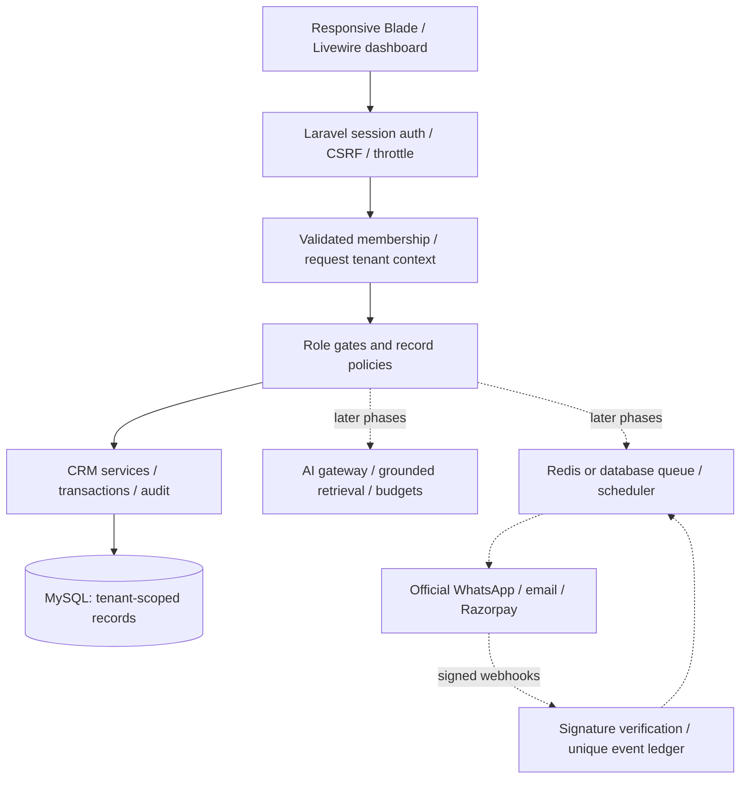

# GrowthDesk architecture and delivery plan

## Repository inspection

The initial workspace contained only `txt`, the product specification. No app, database, theme, or existing features were present. Phase 1 uses Laravel 12 (compatible with the installed PHP 8.2), Blade and Livewire, and MySQL. The original specification is preserved.

Solid lines are implemented in Phase 1; dotted paths are planned. No messaging, AI inference, or paid subscription activation occurs in Phase 1.

## Tenant boundary

Users are global identities. A unique `(tenant_id, user_id)` membership holds a role. Agency users may have explicit memberships in several businesses; agency role alone grants no access to another business. Super admins have a separate global flag and a limited aggregate admin page; they do not bypass tenant data policies. The selected tenant is stored in the server session and revalidated against current membership on **every request**, including Livewire updates. Tenant middleware runs before route bindings and clears context in `finally` for long-lived workers.

Tenant models have a fail-closed global scope: queries without a resolved context fail. Creation sets tenant ID from the server context and rejects conflicting IDs. Policies additionally compare record ownership and membership. Cross-tenant record URLs return 404. Foreign keys `(tenant_id, company_id)` and `(tenant_id, contact_id)` prevent cross-business associations at the database level. Every future job must resolve its tenant in a `try/finally` block before querying tenant models; never serialize credentials into jobs.

## Phase 1 schema (implemented)

| Entity | Relationships / important indexes |
| --- | --- |
| users | Unique email; hashed password; global super-admin flag outside mass assignment |
| tenants | Unique slug; industry, currency, timezone; demo marker |
| memberships | Tenant + user foreign keys; unique pair; role |
| companies | Tenant FK; unique tenant + name; unique tenant + id for composite references |
| contacts | Tenant FK; tenant + email unique (nullable); tenant + phone unique (nullable); composite company FK; tenant + score/source indexes; consent flags; notes |
| deals | Tenant FK; composite contact FK; tenant + stage index; decimal amount; expected close date |
| tasks | Tenant FK; composite contact FK; tenant + due date index; completion timestamp |
| audit_logs | Tenant FK; actor FK; action, subject type/id; tenant + created_at index; no record contents or credentials |
| sessions / cache / jobs / failed_jobs | Standard Laravel infrastructure tables |

Tenant records are removed only by an explicit future business-deletion service. Current CRM delete operations cascade associated deals/tasks; company deletion is not exposed. Application writes and audit inserts are in one transaction. No private uploads or public disk links are introduced.

## Permission matrix

| Role | Read CRM | Write CRM | Export | Future tenant settings |
| --- | --- | --- | --- | --- |
| Agency Owner | Yes (memberships only) | Yes | Yes | Yes |
| Business Owner | Yes | Yes | Yes | Yes |
| Business Manager | Yes | Yes | Yes | Yes |
| Sales Agent | Yes | Yes | No | No |
| Marketing Manager | Yes | No | Yes | No |
| Read-only Analyst | Yes | No | No | No |
| Super Admin | Aggregate admin only; explicit membership required for CRM | By membership | By membership | Global administration planned |

Phase 1 implements CRM read/write/export and aggregate admin permissions. Settings permissions are reserved for future modules, not a claim of implemented administration.

## Delivery phases and acceptance gates

1. **Foundation (this delivery):** session login/logout and throttling, tenant switching, roles/policies, companies, contact CRUD/search/scoring/consent, deals and stage changes, follow-up tasks, measured dashboard, safe CSV export, audit history, explicit disconnected integration status, two-business demo seeder, security tests, setup and operations documentation.
2. **Knowledge + AI:** encrypted integration credentials and owner-only configuration; separate DeepSeek/OpenAI/Claude adapters behind a gateway; provider contract tests, timeout/retry/error mapping, token ledger and atomic budget reservation, permitted fallbacks; approved knowledge ingestion with private files, retrieval, source citations and unknown-question handover. Confirmation tokens for sensitive actions. No fabricated test responses outside test mocks.
3. **Channels:** official WhatsApp webhook handshake/HMAC validation and tenant mapping by server-owned phone ID; durable unique provider event IDs, shared inbox and handover, approved templates and delivery states. Email provider verification, imports/segments/suppression, signed inbound events, unsubscribe tokens and bounce handling. Sandbox contract tests and queues before enabling sending.
4. **Automation + reports:** versioned validated graph (trigger/condition/delay/branch/action), bounded steps and cycles, execution ledger and retry backoff, unique action keys, consent/window/hours/frequency/entitlement checks immediately before sends. Measured delivery funnels, attributable conversions, clearly labeled estimates, scheduled CSV summaries.
5. **Razorpay test billing:** plans/prices/coupons/trials, verified server-side subscriptions, unique signed webhook event ledger, invoices/payments and entitlement state machine, grace periods, upgrades/cancellations, reconciliation and failure tests. Live credentials are a separate deployment configuration.
6. **Release hardening:** team invitation/revocation and password recovery, super-admin support/suspension controls, API tokens/scopes, private document access tests, retention/export/deletion workflows, backup restore drill, worker monitoring, accessibility/browser checks, load tests and independent security review.

## Future schema boundaries (not migrated yet)

All business entities below require tenant FK, tenant-first indexes, policies and isolation tests. Conversations/messages have provider ID deduplication and status history. Campaigns/templates/segments/suppressions/consent_events retain opt-in evidence and opt-outs. Knowledge_documents/chunks/approvals keep source provenance and tenant-scoped retrieval. Integrations encrypt credentials; ai_usage and budget_reservations store numeric token/cost estimates only. Workflows/versions/runs/steps have unique execution keys. Plans/entitlements/subscriptions/payments/invoices/webhook_events record provider authority. An outbox commits external work with domain transactions; consumers use provider idempotency when available and reconciliation for ambiguous responses. Provider logs must redact request bodies, authorization headers and customer content by default.
