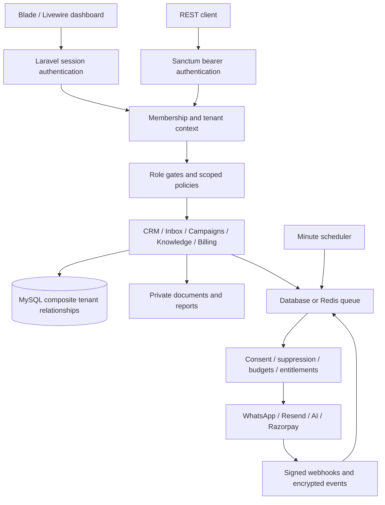

# Architecture and implementation status

## Tenant and permission boundaries

TenantContext is request/job-local and restored or cleared in finally. Models use fail-closed global scopes. Tenant IDs are assigned server-side on inserts and cannot change. Web middleware rechecks membership before route binding, including Livewire. REST middleware uses the tenant on the authenticated token and rechecks membership, role, suspension and abilities. Composite foreign keys reject cross-business CRM and communication relationships.

Owners/agency owners manage teams/billing; managers manage business configuration; marketing managers manage campaigns/automation; sales agents manage CRM/inbox; analysts read only. Super Admin manages global business/user/plan controls without bypassing tenant membership. Ordinary admin screens never expose credentials.

## Persisted entities

- Identity: users, tenants, memberships, sessions, password tokens, invitations and personal access tokens.
- CRM: contacts, companies, deals, tasks/appointments, reminders and audit logs.
- Communications: conversations, messages, evidenced consent, suppressions, templates, campaigns and recipients.
- Intelligence: encrypted integrations, approved knowledge and AI usage reservations/settlements.
- Automation: workflows, execution snapshots and unique event/run keys.
- Revenue: global plans, tenant subscriptions and verified payments.
- Operations: encrypted webhook events, private exports, platform flags, queued/failed jobs.

Migrations 000001 through 000005 define relationships/indexes. Unique tenant/provider, campaign/contact, conversation/channel/contact and workflow/event keys protect against replay. Message UUIDs and provider message IDs protect duplicate processing.

## Provider and execution safety

Adapters use fixed HTTPS hosts, bounded timeouts, safe errors and no redirects. AI adapters share an interface. Retrieval uses relevant approved tenant knowledge; unknown or sensitive questions hand over. Generated output is reviewable. Automatic inbound replies require exact approved FAQ matches. Monthly AI budget is reserved under tenant row locks before network calls. Fallback must be explicit and fit the budget. Configured model prices are estimates.

Enqueueing and delivery check consent evidence, suppression, plan access, windows, business hours and frequency. A worker claims a message once. Ambiguous provider failures become unknown, avoiding blind duplicate sends. Resend also receives idempotency keys. Campaign recipients and workflow steps persist transactional progress. Workflows have at most 12 steps with snapshots, delays, conditions and retry/cancel controls.

Webhook controllers verify raw-body signatures before encrypted storage. Workers process event IDs idempotently. WhatsApp phone IDs must match integration configuration. Resend bounces/complaints suppress recipients. Razorpay events trigger server API reconciliation; redirects and checkout creation alone never grant paid access.

## Delivery and remaining work

Foundation, CRM, tenant isolation, demo dashboards, integrations, AI grounding, inbox, campaigns, automations, reports, test billing, API access, team and admin panels are implemented. Tests exercise SQLite/MySQL and Chrome navigation.

Remaining production work: credentialed provider sandbox tests; richer email composition/segments; WhatsApp template parameters/pagination/creation; semantic retrieval/document parsing; attribution; coupons/setup fees/plan changes/tax invoices; full deletion/retention controls; global provider configuration; monitoring and backup restore exercise. These are not claimed complete.
